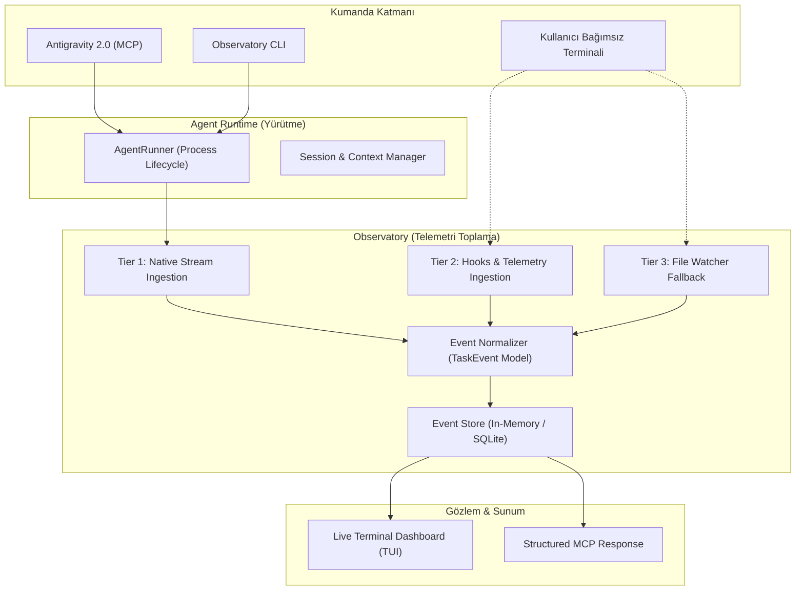

# 🏛️ Agent Observatory Mimarisi

Bu doküman, Agent Observatory platformunun çekirdek mimari ilkelerini, veri akışını ve dokunulmaz sınırlarını tanımlar.

---

## 1. Katmanlar ve Sorumluluk Ayrımı

Sistem iki temel bağımsız motor üzerine kuruludur:



### A. Agent Runtime (Çalışma Zamanı Katmanı)
* **Sorumluluk:** Ajan süreçlerini (child process) başlatmak, durdurmak (`kill`), zaman aşımını yönetmek ve çok turlu (`--resume`, `--continue`) oturum sürekliliğini sağlamak.
* **Kural:** Runtime, gözlem motorunun çökmesinden etkilenmez.

### B. Agent Observatory (Gözlemevi & Telemetri Katmanı)
* **Sorumluluk:** Farklı protokollerden (Claude `stream-json`, Codex JSON-RPC, agy events, hook HTTP payload) gelen heterojen olayları ortak `TaskEvent` formatına çevirmek, mükerrer olayları ayıklamak (deduplication) ve birleşik zaman çizelgesinde (Unified Timeline) saklamak.

---

## 2. Ortak Olay Modeli (`TaskEvent`)

Her ajan olayı aşağıdaki standart şemaya normalize edilir:

```typescript
interface TaskEvent {
  id: string;              // Benzersiz olay ID'si (UUIDv4)
  taskId: string;          // Yürütme görev ID'si (örn. task_9a8b1c)
  sessionId: string;       // Sağlayıcı oturum kimliği (UUID / Thread ID)
  agent: string;           // 'claude' | 'codex' | 'agy' | 'hermes' | 'ollama'
  tier: 1 | 2 | 3;         // 1: Native Stream, 2: Hook, 3: File Fallback
  type: 
    | 'task.started'
    | 'tool.invoked'
    | 'tool.completed'
    | 'message.delta'
    | 'usage.updated'
    | 'task.completed'
    | 'task.failed'
    | 'task.cancelled';
  timestamp: number;       // Unix epoch ms
  data: Record<string, any>;
}
```

---

## 3. Değişmez Mimari Kurallar (Inviolable Rules)

1. **Doğrudan Kaynaktan Öncelik:** Bir ajan için Tier 1 (native stream) mevcutsa, dosya izleyici (Tier 3) o oturum için mükerrer olay üretmez.
2. **Kör Uçuş Yasağı:** Hiçbir CLI görevi arka planda takılı bırakılamaz; her görevin kesin zaman aşımı (timeout) ve iptal mekanizması (`AbortController`) vardır.
3. **Abonelik & Yetki İzolasyonu:** Asla yerel OAuth kimlik bilgileri API anahtarına dönüştürülmeye çalışılmaz; CLI'ların yerel yetki modelleri korunur.
