# 🏢 Nexus AI Ofis — 3D Çoklu Ajan Görselleştirme ve İzleme Motoru
> **Agent Observatory 3D Entegrasyon Katmanı**  
> Konum: `AgentObservatory/nexus_ai_office`

---

## 1. Mimari İlke: Ayrık Durum Deposu (Decoupled State Store)

GitHub'daki en başarılı multi-agent görselleştirme sistemleri (*The Delegation*, *Cubicle*, *ClawProwl*, *Bogdusik AI Office*) incelendiğinde altın standart şudur:

```mermaid
flowchart LR
    subgraph ExecutionPlane["Gerçek Ajan Çalışma Düzlemi"]
        Claude["🟠 Claude Code Sonnet 5.5"]
        Codex["🔴 Codex CLI (gpt-6-astra)"]
        Agy["🔵 Antigravity CLI"]
        OpenCode["⚫ OpenCode (Siyah Takım)"]
    end

    subgraph CoreBridge["Agent Observatory Çekirdeği"]
        Bridge["agent-bridge MCP & Ingest Watchers"]
        EventStore["Ortak Olay Deposu (SQLite WAL / SSE / WebSocket)"]
        Bridge --> EventStore
    end

    subgraph Visualization["3D Nexus Ofis Motoru (Three.js)"]
        Adapter["Olay Adaptörü (Event -> Animasyon Eşleştirici)"]
        Office3D["3D İzometrik Ofis (Odalar, Masalar, Robotlar)"]
        EventStore --> Adapter
        Adapter --> Office3D
    end

    ExecutionPlane --> Bridge
```

Ajan orkestrasyonu ile 3D görsel motor birbirine sıkı sıkıya bağlanmaz. CLI'lar saf kod ve terminal süreçlerini işletirken, oluşturdukları telemetri ve tool çağrıları **Agent Observatory Olay Akışı** (`/api/events`) üzerinden 3D ofise yayınlanır.

---

## 2. Ajan Olayları -> 3D Robot Animasyon Eşleştirmesi

| Ajan Olayı | 3D Robot Durumu | Mekansal Konum | Görsel Efekt & Aksesuar |
| :--- | :--- | :--- | :--- |
| **`IDLE / STANDBY`** | Dinlenme, esneme, etrafa bakma | Dinlenme Odası (Lounge), Koltuk veya Su Sebili | Kahve kupası tutma (`giveMug`), yavaş nefes salınımı |
| **`TASK_DISPATCHED`** | Ayağa kalkma, yürüme | Koridordan ilgili çalışma masasına intikal | Anten lambası yanıp söner, NavMesh rotasında yürüme |
| **`TOOL_CALL: Read / Grep`** | Dosya inceleme, okuma | Çalışma masası veya Kütüphane İstasyonu | Elinde açık parlayan hologram kitap (`giveBook`) |
| **`TOOL_CALL: Edit / Write`** | Hızlı klavye yazımı | Masadaki terminal önü | Monitör neon mavi/turuncu parlar, kafa odaklanır |
| **`TOOL_CALL: Bash / Test`** | Test odası / Komut çalıştırma | Test İstasyonu / Subnautica Pod | Test tüpü yeşil (PASS) veya kırmızı (FAIL) nabız atar |
| **`AUDIT_RELAY (Codex)`** | Çapraz teftiş / İnceleme | Review Room / Teftiş Masası | Claude ve Codex avatarları aynı masada veri paylaşır |
| **`TASK_DONE`** | Kutlama, onay | Masadan kalkıp lobiye dönüş | Başparmak yukarı, rozet yeşil parlar |

---

## 3. Klasör İçeriği & Varlıklar

- **`Core_Engine/`**:
  - `kit.ts`: Three.js sahne, ışıklandırma, kamera kontrolü ve geometri fabrikası.
  - `navigation.ts`: Ajanların odalar ve masalar arasında çarpışmadan yürümesini sağlayan BFS / NavMesh yol bulucu.
  - `world-layout.ts`: Çalışma odaları, koridorlar, kapılar ve istasyon koordinat haritası.
  - `model-catalog.ts` & `i18n.ts`: Ajan model rozetleri ve Türkçe/İngilizce etiketler.
- **`Features_3D/`**:
  - `bots/index.ts`: Claude (Turuncu), Gemini/Agy (Mavi), ChatGPT/Codex (Yeşil/Teal) 3D robot modelleri, anten lambaları ve yürüyüş/yazma iskelet animasyonları.
  - `bots/staff-presets.ts`: Context Compactor (Barista Botu), IPC Dispatcher (Kurye Botu) hazır profilleri.
  - `desks/`: Çift monitörlü çalışma istasyonları, neon terminal ekranları.
  - `rooms/`: Dev Room, Review Room, Test Lab ve Dinlenme Salonu.
  - `environment/`: İzometrik duvarlar, tavan rayları, dinamik gece/gündüz aydınlatması.
- **`TechBase_SpaceStation_3D/`**:
  - Subnautica tüpleri, yüksek teknolojili koridorlar, hava kilitleri ve fütüristik test odası modelleri.
- **`assets/`**:
  - Nexus robot amblemleri, yüksek çözünürlüklü logolar ve UI ikonları.
